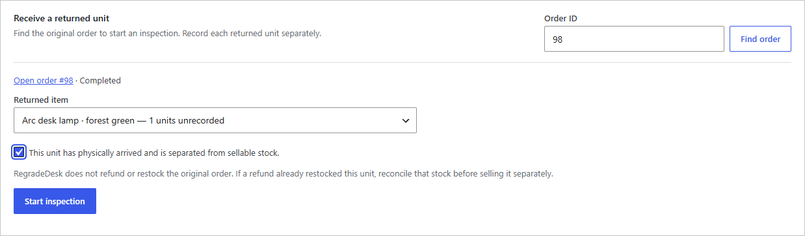
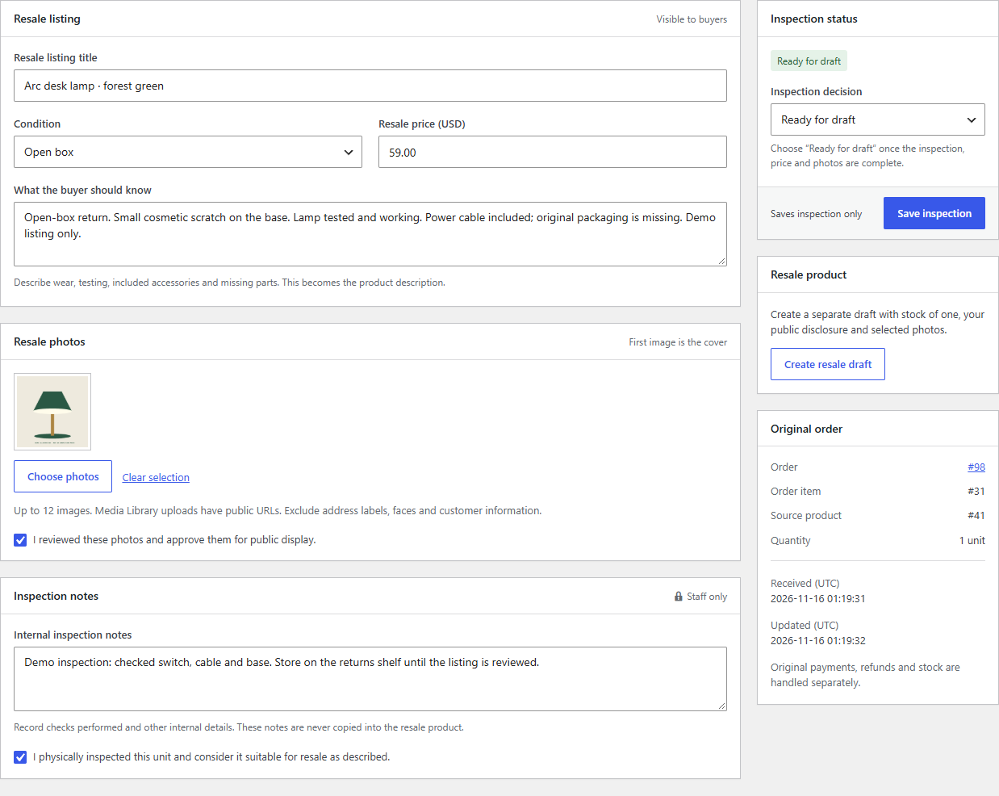
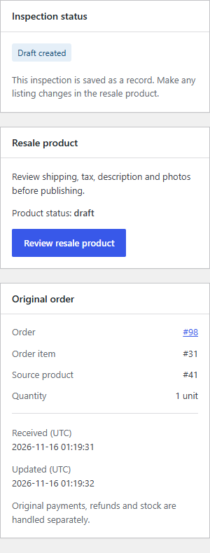
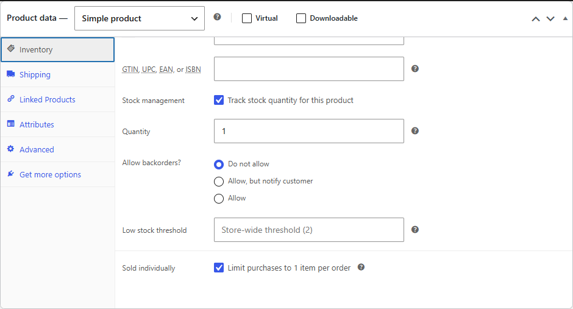

# Your first return-to-resale workflow

Use RegradeDesk to turn one returned item into a separate WooCommerce resale draft, with its condition, photos and original order recorded together.

This guide follows a fictional **Arc desk lamp · forest green**: working, with a scratch on its base and no original packaging. The example resale price is **$59.00**. Screenshots show the local demo running RegradeDesk 0.1.3; order numbers, currency and the WooCommerce editor may differ on your store. The lamp illustration is a demo fixture—use photos of the actual returned unit in your listings.

## Before you start

Install and activate WooCommerce and [RegradeDesk from WordPress.org](https://wordpress.org/plugins/regradedesk/). Use a staging copy for your first trial. Sign in as an administrator or another staff member permitted to manage WooCommerce and edit products.

Have the returned unit and its original order available. This version supports physical simple products and variations on processing, completed or refunded orders. It does not process refunds or change the original product's stock.

**Check your existing returns process first.** If a refund or another tool already restocked this physical unit, reconcile that stock before offering it as a separate resale product. Otherwise you could sell the same item twice.

## 1. Record the physical receipt

Open **WooCommerce → RegradeDesk**. Enter the original order's numeric database ID in **Order ID**, then select **Find order**. If your store uses custom order numbers, use the underlying ID from the order's admin URL.

Choose the correct **Returned item**, confirm that the unit has physically arrived and is separated from sellable stock, then select **Start inspection**.

Record each physical unit separately. “Units unrecorded” means units from that order line without an inspection; it is not a count of items that have actually been returned.

## 2. Describe what the buyer will receive

Inspect the item, then complete the **Resale listing** fields:

| Field | Example |
| --- | --- |
| Resale listing title | Arc desk lamp · forest green |
| Condition | Open box |
| Resale price (USD) | 59.00 |
| What the buyer should know | Open-box return. Small cosmetic scratch on the base. Lamp tested and working. Power cable included; original packaging is missing. |

Choose the condition that accurately describes your unit. The available choices are **Open box**, **Used — good**, **Used — fair**, and **Refurbished**. The example price is illustrative; set a price appropriate to your item and store currency.

Include wear, testing, included accessories and missing parts in **What the buyer should know**. This becomes public product content. For a returned variation, include its size, colour and other identifying details: the resale draft will be a separate simple product.

## 3. Add photos, internal notes and your decision

Select **Choose photos**, choose or upload images, then select **Use these photos**. Add between one and twelve images; the first selected image becomes the cover. Show the actual unit and any visible damage.

**Media Library uploads have public URLs, even while the product is a draft.** Exclude shipping labels, addresses, faces and other customer information. Confirm that you reviewed the photos for public display.

Use **Internal inspection notes** for staff information, such as checks performed and storage location. These notes are not copied to the resale product. Tick the physical inspection confirmation only after you have inspected the unit and consider it suitable for resale as described.

Choose **Ready for draft** under **Inspection decision**, then select **Save inspection**.

If more work is needed, save it as **Needs inspection**. If it is unsuitable for resale, choose **Not for resale**. A rejected inspection still counts as a received unit from that order line.

## 4. Create the separate draft

After saving, select **Create resale draft**. The sidebar changes to **Draft created** and offers **Review resale product**. Select that link to open the WooCommerce product editor.

**Draft created does not mean published.** The original inspection is now frozen as a record. Make listing changes in the linked WooCommerce product.

## 5. Review before publishing

Check the title, price, condition disclosure and photos in the editor. In **Product data → Inventory**, confirm stock management is enabled, quantity is **1**, backorders are disabled, and **Sold individually** is enabled. The draft has its own generated SKU.

Review weight, dimensions, shipping class, tax settings and categories. RegradeDesk copies these from the current source product, so missing packaging or accessories may require adjustments.

Preview the listing as a shopper. Confirm that the description and photos disclose the condition accurately and that internal notes are absent. Complete the original-stock reconciliation before publishing. Publishing is a separate action in WooCommerce; this walkthrough leaves the demo product as a draft.

For a staging trial, publish there and complete a test purchase using your store's test payment setup. Check shipping and tax calculations, confirm only one unit can be purchased, and verify the resale stock is reduced after the order reaches your normal stock-reducing stage. Do not use real payment details for this exercise.

## If you get stuck

| What you see | What to do |
| --- | --- |
| Order not found | Use the numeric database ID, not a formatted order number. |
| No units left to record | Check existing inspections for the order line, including rejected units. Do not create another record for the same physical unit. |
| Create resale draft is unavailable | Save as Ready for draft with a title, condition, positive price, disclosure, at least one photo and both confirmations. Save any subsequent edits before creating the draft. |
| Preparation incomplete | Investigate the reported error, then use Retry draft preparation. It finishes the same reserved draft. |
| Linked product is missing or trashed | Restore the linked product from Trash or a backup. RegradeDesk will not create a replacement automatically. |

For help, use the [WordPress.org support forum](https://wordpress.org/support/plugin/regradedesk/). Include plugin, WordPress and WooCommerce versions, the step that failed and the error text. Remove customer information from screenshots and reports.

## Tell us how the pilot went

After a few returns, note how long receipt-to-draft took, which instructions were unclear, what you corrected in the product editor, and how you reconciled stock. That feedback helps identify the next useful improvement.

---

Maintainers: screenshots are original captures of synthetic local fixtures. To refresh them, start the existing Docker demo and run `node tools/walkthrough-screenshots.mjs` from the repository root. On Windows, an installed Edge browser can be selected with `$env:PLAYWRIGHT_CHANNEL = 'msedge'`. The script creates one synthetic order, inspection and unpublished resale draft per successful run. Never run demo fixture scripts on a real store.
